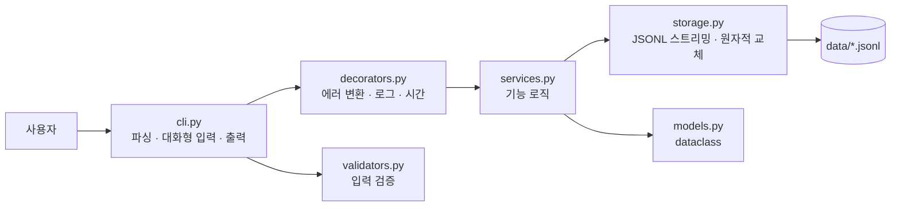

# budget-cli

> Console-based personal budget tracker in pure Python with file-based storage, streaming generators, and CSV import/export
> 표준 라이브러리만으로 구현한 Python 콘솔 가계부: 파일 기반 저장, 제너레이터 스트리밍, CSV 가져오기/내보내기 지원


수입·지출 기록, 검색, 월별 요약, 예산 경고, 카테고리 관리, CSV 가져오기/내보내기까지 갖춘 "작은 서비스" 형태의 콘솔 가계부입니다.
기능 수보다 **예외 상황에서도 데이터가 안전한 구조**에 집중했습니다.

- **10만 건에서도 메모리 59 KB**: 파일을 한 줄씩 읽는 제너레이터 스트리밍 ([측정 결과](docs/performance.md))
- **쓰다가 죽어도 원본이 그대로**: 수정·삭제는 임시 파일에 쓴 뒤 `os.replace` 로 원자적 교체
- **스택트레이스 대신 원인 + 해결 힌트**, 에러 종류별 종료 코드
- **깨진 CSV 도 신뢰할 수 있게**: 부분 성공 / 전체 롤백 / 검증만 하기 + 거부 행 리포트

```console
$ python -m budget_app summary --month 2024-01 --top 3
[2024-01 월별 요약]
총 수입: 3,000,000원
총 지출: 215,000원
잔액: 2,785,000원
예산: 500,000원 (사용률 43.0%) [#########...........]
남은 예산: 285,000원

지출 TOP 3
1)  rent       150,000원  69.8%
2)  food        45,000원  20.9%
3)  transport   20,000원   9.3%
```

## 목차

- [빠른 시작](#빠른-시작)
- [명령어](#명령어)
- [실행 예시](#실행-예시)
- [저장 파일](#저장-파일)
- [CSV 스키마 (import / export)](#csv-스키마-import--export)
- [오류 처리와 종료 코드](#오류-처리와-종료-코드)
- [문제 해결](#문제-해결)
- [아키텍처](#아키텍처)
- [요구사항 구현 매핑](#요구사항-구현-매핑)
- [선택(보너스) 과제 구현 내역](#선택보너스-과제-구현-내역)
- [프로젝트 구조](#프로젝트-구조)
- [테스트](#테스트)
- [문서](#문서)

## 빠른 시작

Python 3.10 이상만 있으면 됩니다. 외부 라이브러리(`pip install`)는 쓰지 않습니다. 기준 버전은 3.14(`.python-version`)이고, [uv](https://docs.astral.sh/uv/) 를 쓰면 `uv run python ...` 으로 같은 버전에서 실행됩니다.

```bash
git clone https://github.com/maebsy/budget-cli.git
cd budget-cli
python -m budget_app --help
```

```console
$ python -m budget_app add
[안내] 데이터 파일을 만들었습니다: data
[안내] 카테고리가 비어 있어 기본 카테고리를 만들었습니다: food, transport, rent, shopping, health, education, culture, salary, allowance, etc
날짜(YYYY-MM-DD, 엔터=오늘): 2024-01-15
타입(income/expense): expense
카테고리: food
금액(양수): 15000
메모(선택): 점심
태그(쉼표로 구분, 없으면 엔터): meal
[저장 완료] id=TX-000001

$ python -m budget_app list --limit 3
ID         날짜        타입     카테고리          금액  메모  태그
---------  ----------  -------  ---------  -----------  ----  -----
TX-000001  2024-01-15  expense  food          15,000원  점심  #meal
(최신순 1건)
```

전체 기능을 한 번에 확인하려면 데모 스크립트를 실행하세요. 임시 폴더를 쓰므로 내 데이터에 영향이 없습니다.

```bash
bash examples/demo.sh                                   # macOS / Linux / Git Bash
powershell -ExecutionPolicy Bypass -File examples\demo.ps1   # Windows PowerShell
```

실제 실행 결과는 [`docs/demo-session.md`](docs/demo-session.md)에 있습니다.

## 명령어

모든 명령은 `python -m budget_app <command> --help` 로 사용법과 예시를 볼 수 있습니다. 옵션은 리눅스 표준인 `--` 형식으로 통일했습니다.

| 명령 | 예시 | 설명 |
| --- | --- | --- |
| `add` | `add` | 대화형 입력. 잘못 입력하면 이유를 보여주고 다시 묻습니다 |
| `list` | `list --limit 10` / `list --plain` | 최신순(날짜 기준) 목록. 기본 20건 |
| `search` | `search --from 2024-01-01 --to 2024-01-31 --type expense` | 조건 검색, 최신순. `--category`, `--q`(메모 키워드), `--tag`, `--month`, `--limit` |
| `summary` | `summary --month 2024-01 --top 3` / `summary --month 2024-02 --compare` | 총수입·총지출·잔액, 예산 사용률·초과 경고, 지출 TOP N. `--compare` 는 전월 대비 수입·지출 증감 |
| `budget` | `budget set --month 2024-01 --amount 500000` | 월 예산 저장. `budget show --month`, `budget list` |
| `category` | `category add cafe` / `category list` / `category remove cafe --replace-with food` | 사용 중인 카테고리는 삭제를 막고, `--replace-with` 로 거래를 옮긴 뒤 삭제 |
| `update` | `update --id TX-000012 --amount 18000 --memo "점심(회식)"` | **옵션 방식으로 고정.** 지정한 항목만 변경, `--tags ""` 는 비우기 |
| `delete` | `delete --id TX-000012` | 없는 id 는 오류 메시지 + 종료 코드 3 |
| `export` | `export --out export.csv --month 2024-01` | 기간 조건(`--month` 또는 `--from`/`--to`) 필수. `--bom`(엑셀용), `--force` |
| `import` | `import --from import.csv` | 부분 성공(기본) / `--atomic`(전체 롤백) / `--dry-run`(검증만) |
| `backup` · `restore` | `backup --label before-import` / `restore --from <zip>` | **[보너스]** 타임스탬프 zip 백업과 복원 |
| `recurring` | `recurring add --type income --category salary --amount 3000000 --day 25` | **[보너스]** 반복 내역 등록, `recurring apply --month 2024-02` 로 자동 생성 |

공통 옵션: `--data-dir DIR`(데이터 폴더, 기본 `./data`, 환경변수 `BUDGET_DATA_DIR`), `--verbose`(실행 시간 표시), `--debug`(예기치 못한 오류의 상세 정보). 명령 앞/뒤 어디에 써도 됩니다.

## 실행 예시

빈 폴더에서 `examples/sample_import.csv`(2024년 2월 거래 5건)를 가져온 뒤 주요 명령을 차례로 실행한 실제 출력입니다.

```console
$ python -m budget_app import --from examples/sample_import.csv
[안내] 데이터 파일을 만들었습니다: data
[안내] 카테고리가 비어 있어 기본 카테고리를 만들었습니다: food, transport, rent, shopping, health, education, culture, salary, allowance, etc
[완료] imported=5, skipped=0
$ python -m budget_app budget set --month 2024-02 --amount 100000
[저장 완료] 2024-02 예산 100,000원
```

**list**: 날짜 기준 최신순입니다. `--plain` 은 과제 예시와 같은 `|` 구분 한 줄 형식입니다.

```console
$ python -m budget_app list --limit 5
ID         날짜        타입     카테고리       금액  메모         태그
---------  ----------  -------  ---------  --------  -----------  ---------------
TX-000005  2024-02-14  expense  shopping   32,000원  선물         #gift
TX-000004  2024-02-10  expense  culture    15,000원  영화         #movie #weekend
TX-000003  2024-02-05  expense  transport   1,250원  지하철       #commute
TX-000002  2024-02-03  income   allowance  50,000원  용돈
TX-000001  2024-02-01  expense  food       12,000원  김밥과 라면  #meal #quick
(최신순 5건, --limit 으로 개수 조절)
$ python -m budget_app list --plain --limit 3
TX-000005 | 2024-02-14 | expense | shopping | 32000 | 선물
TX-000004 | 2024-02-10 | expense | culture | 15000 | 영화
TX-000003 | 2024-02-05 | expense | transport | 1250 | 지하철
```

**search**: 조건은 모두 AND 로 묶이고, 결과 아래에 수입·지출 합계를 붙입니다.

```console
$ python -m budget_app search --category food --month 2024-02
ID         날짜        타입     카테고리      금액  메모         태그
---------  ----------  -------  --------  --------  -----------  ------------
TX-000001  2024-02-01  expense  food      12,000원  김밥과 라면  #meal #quick
(검색 결과 1건 · 수입 0원 · 지출 12,000원)
```

**summary**: 예산을 설정한 달은 사용률과 막대를 보여 줍니다. 80% 이상이면 `[주의]`, 초과하면 `[경고]` 가 붙습니다.

```console
$ python -m budget_app summary --month 2024-02
[2024-02 월별 요약]
총 수입: 50,000원
총 지출: 60,250원
잔액: -10,250원
예산: 100,000원 (사용률 60.2%) [############........]
남은 예산: 39,750원

지출 TOP 3
1)  shopping  32,000원  53.1%
2)  culture   15,000원  24.9%
3)  food      12,000원  19.9%
```

**update / delete**: 바뀐 항목(전 → 후)과 지운 거래를 그대로 보여 줍니다.

```console
$ python -m budget_app update --id TX-000003 --amount 1400
[수정 완료] TX-000003
  amount: 1250 -> 1400
$ python -m budget_app delete --id TX-000004
[삭제 완료] TX-000004 2024-02-10 expense culture 15,000원 영화
$ python -m budget_app list --limit 5
ID         날짜        타입     카테고리       금액  메모         태그
---------  ----------  -------  ---------  --------  -----------  ------------
TX-000005  2024-02-14  expense  shopping   32,000원  선물         #gift
TX-000003  2024-02-05  expense  transport   1,400원  지하철       #commute
TX-000002  2024-02-03  income   allowance  50,000원  용돈
TX-000001  2024-02-01  expense  food       12,000원  김밥과 라면  #meal #quick
(최신순 4건)
```

### 카테고리 삭제 오류 시나리오

같은 데이터(food 거래 1건 있음)에서 카테고리 삭제가 막히는 경우와 고치는 방법입니다.

```console
$ python -m budget_app category remove food
[오류] 카테고리 'food' 는 거래 1건에서 사용 중이라 삭제할 수 없습니다.
[힌트] --replace-with <다른 카테고리> 를 지정하면 거래를 옮긴 뒤 삭제합니다.
$ echo $?
4
$ python -m budget_app category remove food --replace-with nosuch
[오류] 대체 카테고리가 없습니다: nosuch
[힌트] 먼저 category add 로 만드세요.
$ echo $?
3
$ python -m budget_app category remove nosuch
[오류] 없는 카테고리입니다: nosuch
[힌트] category list 로 목록을 확인하세요.
$ echo $?
3
$ python -m budget_app category remove food --replace-with etc
[삭제 완료] category=food (거래 1건을 'etc' 로 옮김)
$ python -m budget_app list --plain --limit 5
…
TX-000001 | 2024-02-01 | expense | etc | 12000 | 김밥과 라면
```

| 상황 | 종료 코드 | 고치는 방법 |
| --- | --- | --- |
| 거래가 있는 카테고리 삭제 | `4` (충돌) | `--replace-with <다른 카테고리>` 로 거래를 옮기면서 삭제 |
| `--replace-with` 에 없는 카테고리 | `3` (대상 없음) | `category add <이름>` 으로 먼저 만들거나 `category list` 에 있는 이름 사용 |
| 없는 카테고리 삭제 | `3` (대상 없음) | `category list` 로 이름 확인 |
| 대체 카테고리가 삭제할 카테고리와 같음 | `2` (잘못된 입력) | 다른 카테고리 지정 |

오류가 나면 어떤 경우든 데이터는 바뀌지 않습니다. 거래 이동과 카테고리 삭제는 둘 다 원자적 교체로 저장합니다.

## 저장 파일

저장 형식은 **JSONL**(한 줄에 JSON 객체 하나)입니다. 기본 위치는 실행한 폴더의 `./data` 이고 `--data-dir` 로 바꿀 수 있습니다.

| 파일 | 내용 |
| --- | --- |
| `data/transactions.jsonl` | 거래 내역 |
| `data/categories.jsonl` | 카테고리 목록 |
| `data/budgets.jsonl` | 월 예산 |
| `data/recurring.jsonl` | **[보너스]** 반복 내역 규칙 |
| `data/app.log` | 명령 실행 로그 (명령·인자·종료 코드·소요 시간) |
| `data/backups/` | **[보너스]** `backup-YYYYMMDD-HHMMSS.zip` |

```json
{"id": "TX-000001", "type": "expense", "date": "2024-01-15", "amount": 15000, "category": "food", "memo": "점심", "tags": ["meal"], "source": null, "created_at": "2024-01-15T12:30:00", "updated_at": null}
```

- 파일이 없으면 자동으로 만들고 `[안내]` 를 출력합니다.
- 카테고리 파일이 비어 있으면 기본 카테고리 10개를 만듭니다(과제의 **안 A**).
- 금액은 원 단위 양의 정수로 저장합니다. `float` 는 `0.1 + 0.2 != 0.3` 같은 오차가 있어 돈 계산에 쓰지 않습니다.
- JSONL 을 고른 이유(태그 목록 표현, 필드 추가에 강함, 줄 단위 스트리밍)와 CSV 와의 비교표는 [`docs/design.md` 3.2절](docs/design.md#32-jsonl-을-선택한-이유)에 정리했습니다.

### 재실행 후에도 데이터가 남는지 확인

빈 폴더에서 거래 1건을 넣고, **프로그램이 끝난 뒤 새로 실행해도** 같은 거래가 보이는지 확인한 실제 기록입니다.

```console
$ python -m budget_app list                      # ① 처음 실행: 파일 생성, 거래 없음
[안내] 데이터 파일을 만들었습니다: data
[안내] 카테고리가 비어 있어 기본 카테고리를 만들었습니다: food, transport, rent, shopping, health, education, culture, salary, allowance, etc
거래 내역이 없습니다. 'add' 로 첫 거래를 등록하세요.
$ cat data/transactions.jsonl                    # ② 저장 파일은 비어 있음
$ printf "2024-01-15\nexpense\nfood\n15000\n점심\nmeal\n" | python -m budget_app add
날짜(YYYY-MM-DD, 엔터=오늘): 2024-01-15
…
[저장 완료] id=TX-000001                          # ③ 프로세스 종료
$ python -m budget_app list                      # ④ 새 프로세스로 다시 실행
ID         날짜        타입     카테고리      금액  메모  태그
---------  ----------  -------  --------  --------  ----  -----
TX-000001  2024-01-15  expense  food      15,000원  점심  #meal
(최신순 1건)
$ cat data/transactions.jsonl                    # ⑤ 파일에 JSON 한 줄이 남아 있음
{"id": "TX-000001", "type": "expense", "date": "2024-01-15", "amount": 15000, "category": "food", "memo": "점심", "tags": ["meal"], "source": null, "created_at": "2026-11-09T17:47:13", "updated_at": null}
$ ls data
app.log
budgets.jsonl
categories.jsonl
recurring.jsonl
transactions.jsonl
```

같은 내용은 `test_data_survives_reopen`(tests/test_storage.py)이 자동으로 검사합니다.

### 수정 · 삭제가 안전한 이유와 주의할 점

수정 · 삭제는 원본을 직접 고치지 않습니다. **같은 폴더**에 임시 파일을 만들어 전체 내용을 쓰고, `flush` · `fsync` 로 디스크에 확정한 뒤 `os.replace` 로 한 번에 바꿔치기합니다([`storage.py`](budget_app/storage.py) `JsonlFile.rewrite`). 중간에 꺼지면 원본이 그대로 남고 임시 파일만 남거나 지워집니다.

- 임시 파일을 원본과 같은 폴더에 만드는 이유: `os.replace` 는 **같은 파일 시스템 안에서만** 이름표만 바꾸는 한 번의 작업(원자적)입니다. 다른 디스크 사이에서는 `OSError: Invalid cross-device link` 로 실패하거나, 다른 도구라면 복사가 되어 도중에 끊길 수 있습니다.
- `--data-dir` 은 **로컬 디스크 폴더**를 권장합니다. 네트워크 드라이브나 동기화 폴더(OneDrive 등)는 교체가 원자적이지 않을 수 있습니다.
- 데이터 파일(`transactions.jsonl` 등)을 다른 디스크를 가리키는 심볼릭 링크로 두지 마세요. 교체하면 링크 자리에 일반 파일이 생깁니다. 폴더를 옮기고 싶으면 `--data-dir` 로 폴더 자체를 지정하세요.
- Windows 에서 엑셀 등이 데이터 파일을 열고 있으면 교체가 실패합니다. 이때도 원본은 그대로이고 `[오류] 파일을 저장하지 못했습니다` 와 힌트가 출력됩니다.

## CSV 스키마 (import / export)

| column | required | 설명 |
| --- | --- | --- |
| `date` | Y | `YYYY-MM-DD` |
| `type` | Y | `income` / `expense` |
| `category` | Y | 등록된 카테고리 |
| `amount` | Y | 양의 정수 |
| `memo` | N | 문자열 |
| `tags` | N | 쉼표(,) 구분 문자열 |

공통: **UTF-8, 헤더 포함.**

```csv
date,type,category,amount,memo,tags
2024-02-01,expense,food,12000,김밥과 라면,"meal,quick"
2024-02-03,income,allowance,50000,용돈,
```

- import 는 엑셀이 붙이는 BOM 과 헤더 대소문자를 허용합니다. UTF-8 이 아니면 "엑셀에서 'CSV UTF-8' 로 저장" 하라고 안내합니다.
- 깨진 행이 있으면 줄 번호와 사유를 출력하고, 거부된 행을 `<파일>.rejected.csv` 에 `error` 컬럼과 함께 저장합니다. 고친 뒤 그 파일만 다시 넣으면 됩니다.
- 거부 행이 많아도 화면에는 **처음 20건만** 보여 주고 나머지는 `[건너뜀] … 외 N건` 한 줄로 줄입니다. 전체 목록은 `.rejected.csv` 에 모두 남고, 마지막 `[완료] imported=…, skipped=…` 줄이 숫자로 요약합니다(`test_many_rejected_rows_are_capped_on_screen`).

### 실제 파일 예시

`export` 로 만든 파일의 앞부분입니다. 헤더 순서는 위 표와 같고, 쉼표가 들어간 `tags` 는 따옴표로 감쌉니다.

```console
$ python -m budget_app export --out export.csv --month 2024-02
[완료] export.csv (5 records)
$ head -3 export.csv
date,type,category,amount,memo,tags
2024-02-01,expense,food,12000,김밥과 라면,"meal,quick"
2024-02-03,income,allowance,50000,용돈,
```

`--bom` 을 붙이면 파일 맨 앞에 UTF-8 BOM(16진수 `EF BB BF`, `od` 의 8진수 표기로 `357 273 277`)이 들어가 엑셀에서 한글이 깨지지 않습니다.

```console
$ python -m budget_app export --out excel.csv --month 2024-02 --bom
[완료] excel.csv (5 records)
$ head -c 3 excel.csv | od -An -c
 357 273 277
```

아래 `import` 예시가 만든 거부 행 리포트(`examples/broken_import.rejected.csv`)는 원래 컬럼 뒤에 `error` 컬럼이 붙습니다.

```csv
date,type,category,amount,memo,tags,error
2024-02-30,expense,food,5000,존재하지 않는 날짜,,존재하지 않는 날짜입니다: 2024-02-30
2024-03-02,expense,unknown,3000,등록되지 않은 카테고리,,등록되지 않은 카테고리: unknown
2024-03-03,expense,transport,-100,음수 금액,,금액은 0보다 커야 합니다: -100
2024-03-04,refund,food,1000,허용되지 않는 타입,,허용되지 않는 타입입니다: refund
```

```console
$ python -m budget_app import --from examples/broken_import.csv
[건너뜀] 3번째 줄: 존재하지 않는 날짜입니다: 2024-02-30
[건너뜀] 4번째 줄: 등록되지 않은 카테고리: unknown
[건너뜀] 5번째 줄: 금액은 0보다 커야 합니다: -100
[건너뜀] 6번째 줄: 허용되지 않는 타입입니다: refund
[완료] imported=2, skipped=4
[힌트] 거부된 행은 'examples/broken_import.rejected.csv' 에 사유와 함께 저장했습니다. 고쳐서 다시 import 하세요.
```

| 옵션 | 동작 |
| --- | --- |
| (기본) | 부분 성공: 올바른 행만 저장 |
| `--atomic` | 한 행이라도 틀리면 아무것도 저장하지 않음 (롤백) |
| `--dry-run` | 검증만 하고 저장하지 않음 |
| `--skip-duplicates` | 같은 날짜·타입·카테고리·금액·메모의 기존 거래는 건너뜀 |
| `--create-categories` | 없는 카테고리를 자동 등록 |

## 오류 처리와 종료 코드

오류는 스택트레이스 대신 **원인 + 해결 힌트**로 출력합니다(stderr).

```console
$ python -m budget_app delete --id TX-999999
[오류] id=TX-999999 거래를 찾을 수 없습니다.
[힌트] list 또는 search 로 id 를 확인하세요.
$ echo $?            # PowerShell: $LASTEXITCODE
3
```

| 코드 | 의미 | 재현 명령 예 |
| --- | --- | --- |
| `0` | 성공 | `list --limit 3` |
| `1` | 예기치 못한 오류 (`--debug` 로 상세 확인) | 정상 사용으로는 나오지 않음(버그일 때). 테스트에서 일부러 예외를 일으켜 확인 |
| `2` | 잘못된 입력·옵션 | `list --limit abc` |
| `3` | 대상 없음 (거래 id, 카테고리, 파일) | `delete --id TX-999999` |
| `4` | 상태 충돌 (사용 중인 카테고리 삭제, 이미 있는 파일) | 거래가 있는 상태에서 `category remove food` |
| `5` | 데이터 파일 손상·입출력 실패 | `transactions.jsonl` 에 깨진 줄을 넣고 `list` |
| `130` | 사용자 취소 (Ctrl+C, 입력 종료) | `add` 도중 Ctrl+C |

상수는 [`errors.py`](budget_app/errors.py)에 모여 있고, 에러 종류(클래스)마다 종료 코드가 정해져 있습니다.

### 쉘에서 종료 코드 확인하기

빈 폴더에서 차례로 실행한 실제 기록입니다. bash · zsh 는 `echo $?`, PowerShell 은 `$LASTEXITCODE` 로 확인합니다.

```console
$ python -m budget_app list --limit 3 > /dev/null; echo $?
[안내] 데이터 파일을 만들었습니다: data
[안내] 카테고리가 비어 있어 기본 카테고리를 만들었습니다: food, transport, rent, shopping, health, education, culture, salary, allowance, etc
0
$ python -m budget_app list --limit abc
[오류] --limit 은(는) 1 이상의 정수여야 합니다: abc
[힌트] 예: 10
$ echo $?
2
$ python -m budget_app delete --id TX-999999
[오류] id=TX-999999 거래를 찾을 수 없습니다.
[힌트] list 또는 search 로 id 를 확인하세요.
$ echo $?
3
$ python -m budget_app import --from examples/sample_import.csv > /dev/null
$ python -m budget_app category remove food
[오류] 카테고리 'food' 는 거래 1건에서 사용 중이라 삭제할 수 없습니다.
[힌트] --replace-with <다른 카테고리> 를 지정하면 거래를 옮긴 뒤 삭제합니다.
$ echo $?
4
$ echo '{broken' >> data/transactions.jsonl     # 일부러 파일을 망가뜨림
$ python -m budget_app list
[오류] transactions.jsonl 의 6번째 줄이 손상되었습니다.
[힌트] 해당 줄을 직접 고치거나 'restore' 로 백업을 복원하세요.
$ echo $?
5
```

스크립트에서는 `if ! python -m budget_app import --from new.csv --atomic; then echo "가져오기 실패"; fi` 처럼 종료 코드로 성공 여부를 판단할 수 있습니다. 모든 오류 종료 코드가 0 이 아닌지는 `test_all_error_exit_codes_are_non_zero` 가 검사합니다.

## 문제 해결

자주 마주치는 메시지와 해결 절차입니다. 메시지는 모두 `[오류]` 로 시작하고, 바로 아래 `[힌트]` 줄에도 해결 방법이 나옵니다.

| 이런 메시지가 나오면 | 해결 절차 |
| --- | --- |
| `데이터 폴더를 만들 수 없습니다: … (Permission denied)` | ① 쓰기 권한이 있는 폴더를 `--data-dir ~/budget-data` 처럼 지정합니다. ② 그 폴더를 꼭 써야 하면 소유자 · 권한을 확인합니다(`ls -ld <폴더>`, 필요하면 `chmod u+w <폴더>`). |
| `transactions.jsonl 의 N번째 줄이 손상되었습니다.` | ① 편집기로 N번째 줄을 열어 고치거나 지웁니다(한 줄 = JSON 하나). ② 고치기 어렵다면 `backup --list` 로 백업을 찾아 `restore --from <zip>` 으로 되돌립니다(복원 직전 상태도 자동 백업됨). |
| `파일을 저장하지 못했습니다: …` | ① 엑셀 등 데이터 파일을 연 프로그램을 닫고 같은 명령을 다시 실행합니다. ② 원본은 바뀌지 않았으니 데이터 걱정은 하지 않아도 됩니다. 디스크 여유 공간도 확인합니다. |
| `등록되지 않은 카테고리: …` / `없는 카테고리입니다: …` | ① `category list` 로 이름을 확인합니다. ② 새로 쓰려면 `category add <이름>`, CSV 라면 `import --create-categories` 로 한 번에 등록합니다. |
| `CSV 헤더에 필수 컬럼이 없습니다: …` / `CSV 를 UTF-8 로 읽을 수 없습니다: …` | ① 첫 줄이 `date,type,category,amount,memo,tags` 인지 확인합니다. ② 엑셀에서는 "CSV UTF-8" 형식으로 저장하고, 넣기 전에 `import --from <파일> --dry-run` 으로 먼저 검증합니다. |
| `예기치 못한 문제가 발생했습니다: …` (종료 코드 1) | ① 같은 명령에 `--debug` 를 붙여 상세 정보를 확인합니다. ② `data/app.log` 의 마지막 줄(명령 · 인자 · 종료 코드)과 함께 이슈로 남겨 주세요. |

## 아키텍처



| 계층 | 모듈 | 책임 |
| --- | --- | --- |
| 프레젠테이션 | `cli.py`, `prompts.py`, `formatting.py` | 명령어 파싱, 대화형 입력·재입력, 표 출력 |
| 공통 관심사 | `decorators.py` | `@handle_errors` · `@log_command` · `@timed` |
| 서비스 | `services.py` | 검색 조건, 월별 집계, 카테고리 삭제 정책, import 정책 |
| 저장소 | `storage.py` | JSONL 읽기(제너레이터)/append/원자적 재작성 |
| 모델 | `models.py`, `validators.py`, `errors.py` | 데이터 구조, 입력 규칙, 에러와 종료 코드 |

의존은 위 → 아래 한 방향이며, 테스트(`test_layer_dependency_direction`)가 import 문을 분석해 이 규칙을 지키는지 확인합니다. 자세한 내용은 [`docs/design.md`](docs/design.md)에 있습니다.

```bash
python -m unittest tests.test_structure -v     # 계층 의존 방향 · 표준 라이브러리만 사용 · 타입 힌트 · docstring 검사
```

## 요구사항 구현 매핑

| 요구사항 | 구현 | 검증 |
| --- | --- | --- |
| 10가지 기능 (add, list, search, summary, budget, category, update, delete, import, export) | [`cli.py`](budget_app/cli.py) → [`services.py`](budget_app/services.py) | `tests/test_cli.py`, `tests/test_services.py` |
| 데이터 3개 이상 파일 영구 저장 | `transactions` / `categories` / `budgets` `.jsonl` | `test_data_survives_reopen` |
| dataclass 모델, 클래스 2개 이상 | [`models.py`](budget_app/models.py) (`Transaction` 등 5개) | `test_models_are_dataclasses` |
| 입력 검증 (날짜·금액·타입·카테고리) | [`validators.py`](budget_app/validators.py), 재입력 [`prompts.py`](budget_app/prompts.py) | `test_validators.py`, `test_invalid_input_asks_again` |
| list/search 제너레이터 스트리밍 | `JsonlFile.iter_records` → `heapq.nlargest` | `StreamingMemoryTest` |
| update/delete 안정성 | 임시 파일 + `os.replace` | `test_failed_rewrite_keeps_original_and_cleans_temp_file` |
| 사용 중 카테고리 삭제 처리 | 삭제 막기 + `--replace-with` | `test_remove_in_use_requires_replacement` |
| summary 예산 사용률/초과 경고 | `MonthlySummary.budget_usage`, `over_budget` | `test_over_budget_warning`, `BudgetThresholdTest`(경계값 6개) |
| CSV 스키마 고정 | `CSV_COLUMNS` | `test_export_round_trip_preserves_schema` |
| 데코레이터 1개 이상 적용 | `@command` = 에러·로그·시간 (13개 핸들러 전부) | `test_every_command_handler_is_decorated` |
| 스택트레이스 없는 오류, 0 이 아닌 종료 코드 | [`decorators.py`](budget_app/decorators.py), [`errors.py`](budget_app/errors.py) | `ErrorHandlingTest` |
| 3개 이상 모듈, 표준 라이브러리만 | 9개 모듈 | `test_at_least_three_modules`, `test_only_standard_library` |
| 모든 명령 `--help` | argparse | `test_every_command_supports_help` |

## 선택(보너스) 과제 구현 내역

보너스 4개를 모두 구현했습니다. 코드 docstring 과 `--help` 에도 `[보너스]` 로 표기했습니다.

| 보너스 과제 | 명령 / 위치 | 구현 내용 | 확인 |
| --- | --- | --- | --- |
| **백업 기능** | `backup`, `backup --list`, `restore --from` · `services.py::BackupService` | 타임스탬프 zip + `manifest.json`. 같은 초에 두 번 실행해도 덮어쓰지 않음. 복원 전 모든 줄을 검증하고, 현재 상태를 `before-restore` 로 자동 백업한 뒤 원자적 교체 | `test_backup_and_restore` |
| **반복 내역 기능** | `recurring add/list/remove/apply` · `services.py::RecurringService` | 매달 n일 규칙. 31일 규칙은 2월에 말일로 조정. 생성 거래에 출처(`RC-0001@2024-02`)를 기록해 **여러 번 실행해도 중복 생성 안 함** | `test_recurring_apply_is_idempotent_and_clamps_day` |
| **출력 포맷 테이블 정렬** | 기본 출력 · `formatting.py` | 외부 라이브러리 없이 `unicodedata.east_asian_width` 로 한글 2칸 폭을 계산해 열 정렬. 과제 예시 형식은 `--plain` | `list`, `search`, `summary` 출력 |
| **저장 원자성 강화** | `storage.py::JsonlFile.rewrite` | 임시 파일 기록 → `fsync` → `os.replace`. 실패 시 임시 파일만 삭제. update/delete/예산/카테고리/복원/`import --atomic` 모두 적용 | `test_failed_rewrite_keeps_original_and_cleans_temp_file` |

```console
$ python -m budget_app recurring add --type expense --category rent --amount 500000 --day 31 --memo 월세
[저장 완료] id=RC-0002 (매달 31일 expense rent 500,000원)
$ python -m budget_app recurring apply --month 2024-02
[생성] TX-000011 2024-02-25 income salary 3,000,000원 월급
[생성] TX-000012 2024-02-29 expense rent 500,000원 월세
[완료] 2024-02 반복 내역 created=2, skipped=0
$ python -m budget_app recurring apply --month 2024-02
[완료] 2024-02 반복 내역 created=0, skipped=2 (이미 생성됨: RC-0001, RC-0002)
```

## 프로젝트 구조

```
budget-cli/
├── budget_app/
│   ├── __main__.py      # python -m budget_app 진입점
│   ├── cli.py           # 명령어 파싱, 대화형 입력, 출력
│   ├── decorators.py    # @handle_errors · @log_command · @timed
│   ├── services.py      # 기능 로직 (+ 보너스: 백업, 반복 내역)
│   ├── storage.py       # JSONL 스트리밍 읽기, append, 원자적 재작성
│   ├── models.py        # Transaction, Budget, Category, RecurringRule, SearchFilter
│   ├── validators.py    # 입력 검증·정규화
│   ├── prompts.py       # 재입력 루프
│   ├── formatting.py    # [보너스] 한글 폭을 고려한 표 정렬
│   └── errors.py        # 에러 타입과 종료 코드
├── tests/               # unittest (명령 · 서비스 · 저장소 · 검증 · 데코레이터 · 구조)
├── examples/            # 데모 스크립트, 샘플 CSV (정상 / 깨진 행 포함)
├── scripts/benchmark.py # 1천 ~ 10만 건 성능 측정
└── docs/
    ├── design.md        # 설계 문서
    ├── checklist.md     # 체크리스트 답변서
    ├── performance.md   # 성능 측정과 병목 분석
    ├── demo-session.md  # 데모 실행 기록
    └── presentation.html # 동료 평가 발표 슬라이드
```

## 테스트

```bash
python -m unittest discover -s tests -t . -v
```

| 테스트 파일 | 검증 내용 |
| --- | --- |
| `test_cli.py` | 모든 명령의 출력 형식, 재입력, `--help`, 종료 코드, 과제 예시 흐름, 보너스 명령, 예산 경계값(미설정 · 80% · 100% · 초과), import 거부 행 화면 상한 |
| `test_services.py` | 검색 조건, 요약 집계, 카테고리 정책, import 부분 성공/롤백/dry-run, 백업·복원, 반복 내역 |
| `test_storage.py` | 스트리밍, 원자적 재작성 실패 시 원본 보존, 손상 줄 감지, 메모리 사용량 비교 |
| `test_validators.py` | 날짜·금액·타입·카테고리·태그 규칙 |
| `test_decorators.py` | 에러 변환, 실행 로그, 시간 측정, 메타데이터 보존 |
| `test_structure.py` | 표준 라이브러리만 사용, 계층 의존 방향, dataclass, 데코레이터 적용, 타입 힌트, docstring |

타입 힌트는 [mypy](https://mypy-lang.org/) 로 정적 검사합니다. mypy 는 실행에 필요 없는 개발 도구라 `typecheck` 의존성 그룹에만 두었고(`pyproject.toml`), 설정은 `[tool.mypy]` 에 있습니다.

```bash
uv run --group typecheck mypy    # Success: no issues found in 11 source files
```

검증 단계는 [`.github/workflows/tests.yml`](.github/workflows/tests.yml) 에 **Ubuntu 와 Windows** × Python 3.10 ~ 3.14 로 정의해 두었습니다(mypy 는 Ubuntu 에서만). Windows 에서도 원자적 교체와 한글 입출력이 동작하는지 함께 확인하기 위해서입니다. `uv run scripts/ci_local.py` 로 같은 단계를 내 컴퓨터에서 Python 버전별로 그대로 실행할 수 있습니다 (커밋된 상태 기준, Linux·macOS).

## 문서

| 문서 | 내용 |
| --- | --- |
| [`docs/design.md`](docs/design.md) | 계층·클래스 책임, 저장 방식과 원자적 교체, 스트리밍, 데코레이터, 타입 힌트, 오류 처리 |
| [`docs/checklist.md`](docs/checklist.md) | 미션 체크리스트 전 항목의 근거와 답변 |
| [`docs/performance.md`](docs/performance.md) | 1천 ~ 10만 건 측정, 병목 분석, 개선 방향 |
| [`docs/demo-session.md`](docs/demo-session.md) | 데모 스크립트 실제 실행 결과 |
| [`docs/feedback-checklist.md`](docs/feedback-checklist.md) | 동료 평가 피드백 16건과 반영 위치 |
| [`docs/presentation.html`](docs/presentation.html) | 동료 평가 발표 슬라이드 71장 (브라우저로 열기, ← → 넘기기 · N 발표자 노트 · 인쇄하면 PDF) |
