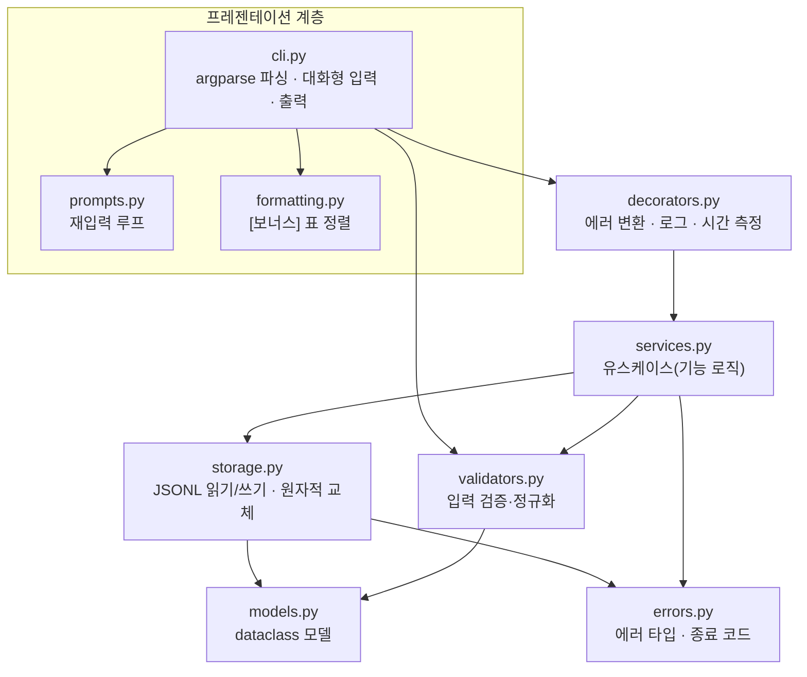

# 설계 문서

## 1. 계층 구조



**의존 방향은 위 → 아래 한 방향**입니다. 아래 계층은 위 계층을 모릅니다.
`storage.py` 는 화면이 있는지 모르고, `services.py` 는 `print` 를 하지 않습니다. 이 규칙은 `tests/test_structure.py::test_layer_dependency_direction` 이 import 문을 분석해서 자동으로 검사합니다.

| 모듈 | 책임 | 하지 않는 일 |
| --- | --- | --- |
| `models.py` | 데이터 모양(dataclass)과 JSON 레코드 변환 | 파일 I/O, 화면 출력 |
| `validators.py` | 문자열 → 올바른 값 변환, 원인+힌트를 담은 `ValidationError` | 저장, 출력 |
| `storage.py` | JSONL 파일 스트리밍 읽기, append, 원자적 재작성 | 비즈니스 규칙(카테고리 사용 여부 판단 등) |
| `services.py` | 기능 로직: 검색 조건 적용, 요약 집계, 카테고리 삭제 정책, import 정책 | 파일 형식, 출력 형식 |
| `decorators.py` | 모든 명령에 공통인 에러 변환·실행 로그·시간 측정 | 기능 로직 |
| `cli.py` | 명령어 파싱, 대화형 입력, 서비스 호출, 결과 출력 | 계산, 파일 접근 |

이렇게 나누면 **바꾸는 이유가 하나인 곳만 고치면 됩니다.** 저장 형식을 CSV 로 바꾸면 `storage.py` 만, 출력 모양을 바꾸면 `cli.py`/`formatting.py` 만 수정합니다. 서비스는 화면 없이 값을 반환하므로 `tests/test_services.py` 처럼 CLI 를 거치지 않고 바로 테스트할 수 있습니다.

## 2. 클래스와 책임 경계

| 클래스 | 하나의 책임 | 근거 |
| --- | --- | --- |
| `Transaction` (frozen dataclass) | 거래 1건의 값 | 불변 객체라 수정은 `with_changes()` 로 새 객체 → "언제 바뀌었나"가 명확 |
| `JsonlFile` | JSONL 파일 1개의 저수준 I/O | 스트리밍·append·원자적 교체를 한 곳에 모아 모든 저장소가 재사용 |
| `TransactionRepository` | 거래 파일 CRUD | 전체 로드 메서드를 **제공하지 않음** → 실수로 메모리에 다 올리는 코드를 막음 |
| `CategoryStore` / `BudgetStore` | 카테고리 / 월 예산 파일 | 데이터 수가 적어 목록 단위로 처리 |
| `TransactionService` | 추가·조회·검색·수정·삭제 규칙 | "카테고리가 등록돼 있어야 한다" 같은 규칙 |
| `SummaryService` / `MonthlySummary` | 월별 집계 / 집계 결과 값 | 계산(서비스)과 결과(값 객체) 분리 → 출력 코드는 값만 읽음 |
| `CategoryService` | 카테고리 정책 | "사용 중이면 대체 카테고리를 요구" 를 저장소가 아니라 서비스가 결정 |
| `ImportExportService` | CSV 스키마와 부분 성공/롤백 정책 | |
| `BackupService`, `RecurringService` | [보너스] 백업·복원, 반복 내역 | |
| `App` | 저장소들을 만들어 서비스에 넘기는 컨테이너 | 서비스가 파일 경로를 직접 만들지 않게 (의존성 주입) |

책임 경계를 정한 기준은 **"이 클래스를 바꿔야 하는 이유가 하나인가"** 입니다. 예를 들어 `CategoryStore.remove()` 는 사용 중인지 검사하지 않습니다. 사용 여부는 거래 파일을 봐야 알 수 있고, "막을지/옮길지"는 정책이기 때문에 `CategoryService.remove()` 가 판단합니다.

## 3. 저장 방식

### 3.1 파일 구성 (`--data-dir`, 기본 `./data`)

| 파일 | 내용 | 한 줄 예시 |
| --- | --- | --- |
| `transactions.jsonl` | 거래 | `{"id": "TX-000001", "type": "expense", "date": "2024-01-15", "amount": 15000, "category": "food", "memo": "점심", "tags": ["meal"], "source": null, "created_at": "…", "updated_at": null}` |
| `categories.jsonl` | 카테고리 | `{"name": "food", "created_at": "…"}` |
| `budgets.jsonl` | 월 예산 | `{"month": "2024-01", "amount": 500000, "updated_at": "…"}` |
| `recurring.jsonl` | [보너스] 반복 규칙 | `{"id": "RC-0001", "type": "income", "category": "salary", "amount": 3000000, "day": 25, …}` |
| `app.log` | 실행 로그 (데코레이터) | `{"ts": "…", "command": "list", "args": {…}, "exit_code": 0, "elapsed_ms": 0.6}` |
| `backups/` | [보너스] `backup-YYYYMMDD-HHMMSS.zip` | |

- 처음 실행하면 폴더와 빈 파일을 만들고 `[안내]` 를 출력합니다.
- 카테고리 파일이 비어 있으면 **안 A(기본 카테고리 자동 생성)** 를 택했습니다: `food, transport, rent, shopping, health, education, culture, salary, allowance, etc`. 처음 쓰는 사람이 `add` 를 바로 할 수 있게 하기 위해서이고, 한 번 만든 뒤에는 사용자가 지워도 다시 만들지 않습니다.

### 3.2 JSONL 을 선택한 이유

| 기준 | JSONL | CSV |
| --- | --- | --- |
| 한 줄씩 스트리밍 | 줄 = 객체 1개, `json.loads(line)` | 가능하지만 따옴표 안 줄바꿈 처리 필요 |
| 목록 필드(`tags`) | `["meal", "team"]` 그대로 | `"meal,team"` 처럼 구분자 규칙을 따로 정해야 함 |
| 필드 추가(`source`, `updated_at`) | 옛 줄에 필드가 없어도 `.get()` 으로 읽힘 | 헤더와 모든 행의 컬럼 수를 맞춰야 함 |
| 타입 | 숫자/문자/null 구분 | 전부 문자열 |
| 사람이 엑셀로 보기 | 불편 | 편함 |

내부 저장은 구조 변경에 강한 JSONL 로 하고, 사람이 다루는 교환 형식은 `import`/`export` 의 CSV 로 분리했습니다. 두 형식의 장점을 용도별로 쓰는 구조입니다.

### 3.3 안전한 update / delete (원자적 교체) — [보너스: 저장 원자성 강화]

JSONL 은 줄 길이가 제각각이라 파일 중간을 직접 고칠 수 없습니다. 그래서 수정·삭제는 파일을 새로 씁니다. 이때 쓰는 도중 프로그램이 죽으면 파일이 반쯤 잘릴 수 있으므로 다음 순서를 지킵니다 (`storage.py::JsonlFile.rewrite`).

```
1. 같은 폴더에 임시 파일 생성         transactions.jsonl.ab12.tmp
2. 원본을 한 줄씩 읽으며 바뀐 내용을 임시 파일에 기록 → flush → fsync
3. os.replace(임시, 원본)            ← 운영체제가 보장하는 "한 번에 교체"
4. 2단계 중 예외가 나면 임시 파일만 삭제, 원본은 그대로
```

- 같은 폴더에 임시 파일을 만드는 이유: `os.replace` 는 같은 파일 시스템 안에서만 원자적입니다.
- `fsync` 를 하는 이유: `write` 만 하면 데이터가 OS 버퍼에 머물 수 있어, 교체 직후 전원이 꺼지면 빈 파일이 될 수 있습니다.
- **없는 id 처리도 이 구조로 해결합니다.** 끝까지 읽었는데 대상이 없으면 제너레이터가 `NotFoundError` 를 던지고, `rewrite` 가 임시 파일을 지웁니다. 원본은 수정 시각조차 바뀌지 않습니다(`test_update_and_delete_unknown_id_do_not_touch_file`).
- 실패 상황은 `test_failed_rewrite_keeps_original_and_cleans_temp_file` 이 "쓰는 도중 예외" 를 흉내 내서 검증합니다.

append(add, import) 는 기존 내용을 건드리지 않으므로 파일 끝에 쓰고 `fsync` 합니다.

## 4. 제너레이터 스트리밍

```python
# storage.py
def iter_records(self) -> Iterator[Record]:
    with self.path.open("r", encoding="utf-8") as f:
        for lineno, line in enumerate(f, start=1):   # 파일 객체도 한 줄씩 읽는 이터레이터
            ...
            yield json.loads(line)                     # 한 건 넘기고 멈춤
```

`yield` 를 만나면 함수가 그 자리에서 멈추고 값을 넘깁니다. 다음 값을 요청받아야 다시 이어서 한 줄을 더 읽습니다. 그래서 **메모리에는 지금 처리 중인 한 줄만** 있습니다.

| 명령 | 처리 방식 | 메모리 |
| --- | --- | --- |
| `list --limit N` | 제너레이터 → `heapq.nlargest(N, …, key=(date, id))` | O(N) — 상위 N개만 보관 |
| `search` | 제너레이터 → 조건 필터(제너레이터 식) → 일치 건만 정렬 | O(일치 건수) |
| `summary` | 제너레이터 한 번 순회하며 합계 누적 | O(카테고리 수) |
| `export` | 조건 필터 → 일치 건 날짜순 정렬 → CSV | O(일치 건수) |
| `update`/`delete` | 읽는 제너레이터 → 바꾸는 제너레이터 → 임시 파일 | O(1) |

"최신순"은 등록 순서가 아니라 **날짜 기준**입니다. 지난 달 거래를 나중에 입력해도 제자리에 보이게 하기 위해서입니다. 같은 날짜는 id 가 큰(나중에 등록한) 거래가 먼저입니다. 파일은 등록 순서로 쌓이므로 날짜순으로 뽑으려면 정렬이 필요한데, 전체 정렬 대신 크기 N 짜리 힙을 써서 메모리를 O(N) 으로 묶었습니다.

10만 건에서 `list --limit 20` 은 59 KB, 전체를 리스트로 읽으면 약 60 MB 를 씁니다([`performance.md`](performance.md)). 이 차이는 `tests/test_storage.py::StreamingMemoryTest` 가 매번 검증합니다.

## 5. 데코레이터: 공통 관심사 분리

```python
@command                      # = handle_errors(log_command(timed(handler)))
def cmd_delete(ctx: CommandContext) -> int:
    app = open_app(ctx)
    tx = TransactionService(app).delete(parse_tx_id(ctx.args.id))
    ctx.out("[삭제 완료] {}".format(describe(tx)))
    return EXIT_OK
```

| 데코레이터 | 역할 | 이 데코레이터가 없다면 |
| --- | --- | --- |
| `@handle_errors` | `AppError` → `[오류] 원인` / `[힌트] 해결` + 종료 코드. 예상 못한 예외도 스택트레이스 대신 안내(`--debug` 일 때만 traceback) | 13개 핸들러마다 같은 `try/except` 반복 |
| `@log_command` | 명령·인자·종료 코드·소요 시간을 `app.log` 에 JSON 한 줄로 기록. 실패한 명령도 기록 | 로그 형식이 명령마다 달라짐 |
| `@timed` | 실행 시간을 측정, `--verbose` 면 `[시간] list 0.6ms` 출력 | 성능 확인 코드가 기능 코드에 섞임 |

적용 순서(바깥 → 안): `handle_errors` → `log_command` → `timed`. 에러 처리가 가장 바깥이라 로그 기록 중 문제가 생겨도 사용자에게 스택트레이스가 보이지 않고, 로그는 에러로 끝난 명령도 `exit_code` 와 함께 남깁니다. `functools.wraps` 로 원래 함수 이름과 docstring 을 보존합니다(`test_wraps_preserves_metadata`). 모든 `cmd_*` 핸들러에 데코레이터가 적용됐는지는 `test_every_command_handler_is_decorated` 가 확인합니다.

## 6. 타입 힌트

타입 힌트는 함수의 **입출력 계약**입니다. 몇 가지 예입니다.

```python
def parse_amount(text: str) -> int: ...
# → 호출하는 쪽은 "문자열을 넣으면 int 가 나오거나 예외" 라는 것만 알면 된다.

def list_latest(self, limit: int) -> List[Transaction]: ...
def iter_all(self) -> Iterator[Transaction]: ...
# → 반환 타입만 봐도 하나는 "다 모은 리스트", 하나는 "한 번만 순회 가능한 스트림" 임을 구분할 수 있다.

def update(self, tx_id: str, change: Callable[[Transaction], Transaction]) -> Tuple[Transaction, Transaction]: ...
# → "거래를 받아 거래를 돌려주는 함수"를 넘겨야 하고, (수정 전, 수정 후) 를 받는다는 계약.

amount: int        # Transaction 필드. float 가 아니라 int → 금액 오차가 생길 수 없음을 타입으로 표현
type: TxType       # 문자열 "income"/"expense" 대신 Enum → 오타("incom")가 들어올 자리가 없음
```

실제로 도움이 된 사례: `update` 의 반환값을 `Transaction` 에서 `Tuple[Transaction, Transaction]` 로 바꿀 때, 시그니처를 먼저 고치고 나서 호출부(`services.py`)를 따라가며 맞췄습니다. IDE/정적 분석기(mypy, Pylance)가 시그니처와 다르게 쓰는 곳을 바로 표시해 줍니다. `tests/test_structure.py::test_public_api_has_type_hints` 가 공개 함수에 반환 타입이 빠지지 않았는지 검사합니다.

## 7. 입력 검증, 오류 메시지, 종료 코드

모든 입력 경로(대화형 `add`, 옵션 `--amount`, CSV `import`)가 **같은 검증 함수**(`validators.py`)를 씁니다. 그래서 "대화형에서는 막히는데 CSV 로는 들어가는" 값이 없습니다.

| 입력 | 규칙 | 예시 오류 |
| --- | --- | --- |
| 날짜 | `YYYY-MM-DD` + 실제로 있는 날짜 | `2024-13-40`, `2023-02-29` |
| 금액 | 양의 정수, 쉼표/`원` 허용, 1조 이하 | `0`, `-5`, `12.5` |
| 타입 | `income`/`expense` (한글 `수입`/`지출` 허용) | `refund` |
| 카테고리 | 등록된 카테고리, 소문자로 정규화 | `bus` (→ 사용 가능 목록을 힌트로 출력) |
| 태그 | 쉼표 구분, 소문자, 중복 제거 | |

대화형 입력에서는 잘못 입력하면 원인과 힌트를 보여주고 **같은 질문을 다시** 합니다. 파이프 입력이 계속 틀려서 무한 반복하는 일을 막기 위해 5번 연속 실패하면 멈춥니다.

| 종료 코드 | 의미 | 예 |
| --- | --- | --- |
| 0 | 성공 | |
| 1 | 예기치 못한 오류 | 버그 (`--debug` 로 상세 확인) |
| 2 | 잘못된 입력·옵션 | 날짜 형식, 알 수 없는 옵션, import 검증 실패 |
| 3 | 대상 없음 | 없는 거래 id, 없는 카테고리, 없는 파일 |
| 4 | 상태 충돌 | 사용 중인 카테고리 삭제, 이미 있는 파일 |
| 5 | 데이터 손상·입출력 실패 | 손상된 JSONL 줄 (줄 번호와 복원 방법 안내) |
| 130 | 사용자 취소 | Ctrl+C, 입력 종료(EOF) |

정상 출력은 stdout, 오류·안내는 stderr 로 보내서 `python -m budget_app list --plain > out.txt` 처럼 리다이렉션해도 안내 문구가 섞이지 않습니다.

## 8. CLI 규칙

- 모든 옵션은 `--` 형식이고, 모든 명령과 하위 명령이 `--help` 를 지원합니다(`test_every_command_supports_help`).
- `--data-dir`, `--verbose`, `--debug` 는 명령 앞/뒤 어디에 써도 됩니다.
- `add` 는 대화형이 기본입니다.
- **`update` 는 옵션 방식(안 A)으로 고정했습니다.** `update --id TX-000012 --amount 18000 --memo "점심(회식)"` 처럼 바꿀 필드만 지정하고, `--memo ""` / `--tags ""` 는 비우기입니다. 스크립트로 일괄 수정하기 쉽고, 무엇을 바꿨는지 명령 한 줄에 남기 때문입니다.
- argparse 의 영문 오류도 `[오류] / [힌트]` 형식으로 바꿔 출력합니다(`KoreanArgumentParser`).

## 9. CSV import / export

| column | required | 설명 |
| --- | --- | --- |
| `date` | Y | `YYYY-MM-DD` |
| `type` | Y | `income` / `expense` |
| `category` | Y | 등록된 카테고리 |
| `amount` | Y | 양의 정수 |
| `memo` | N | 문자열 |
| `tags` | N | 쉼표 구분 문자열 (CSV 안에서는 `"meal,team"` 처럼 따옴표) |

공통: UTF-8, 헤더 포함. 읽을 때는 `utf-8-sig` 로 열어 엑셀이 붙이는 BOM 도 허용하고, 헤더 대소문자는 무시합니다. 내보낼 때 `--bom` 을 주면 엑셀에서 한글이 깨지지 않습니다.

### 깨진 행이 섞인 CSV 를 가져올 때

| 모드 | 동작 | 언제 |
| --- | --- | --- |
| 기본 (부분 성공) | 올바른 행만 저장. 거부된 행은 줄 번호·사유를 출력하고 `<파일>.rejected.csv` 에 `error` 컬럼을 붙여 저장 | 대부분의 경우. 고친 뒤 rejected 파일만 다시 import |
| `--atomic` (롤백) | 한 행이라도 틀리면 아무것도 저장하지 않음. 저장할 때도 기존+신규를 임시 파일에 쓴 뒤 한 번에 교체 | 은행 내역처럼 일부만 들어가면 합계가 틀어지는 데이터 |
| `--dry-run` | 검증만 하고 저장하지 않음 | 가져오기 전 미리 확인 |
| `--skip-duplicates` | 같은 날짜·타입·카테고리·금액·메모인 기존 거래는 건너뜀 | 같은 파일을 두 번 넣는 실수 방지 |

사용자 신뢰를 지키는 핵심은 **"무엇이 들어갔고 무엇이 빠졌는지를 숨기지 않는 것"** 입니다. 조용히 건너뛰지 않고 건수와 줄 번호를 보여주며, 거부된 행을 고쳐서 다시 넣을 수 있는 파일까지 남깁니다.

## 10. 보너스 기능

| 기능 | 명령 | 설계 포인트 |
| --- | --- | --- |
| 백업 | `backup [--label]`, `backup --list`, `restore --from` | 타임스탬프 zip + `manifest.json`(버전, 파일별 건수). 같은 초에 두 번 실행해도 덮어쓰지 않음. 복원 전 **모든 줄을 먼저 검증**하고, 현재 상태를 `before-restore` 로 자동 백업한 뒤 파일마다 원자적 교체 |
| 반복 내역 | `recurring add/list/remove/apply` | 매달 n일 규칙. 31일 규칙은 2월에 28/29일로 맞춤. 생성한 거래에 `source="RC-0001@2024-02"` 를 남겨 **여러 번 실행해도 중복 생성하지 않음(멱등)** |
| 표 정렬 | `list`, `search` 등 기본 출력 | `unicodedata.east_asian_width` 로 한글 폭(2칸)을 계산해 열을 맞춤. 과제 예시 형식은 `--plain` |
| 저장 원자성 | 모든 수정·삭제·예산·카테고리 변경 | 3.3절 |

## 11. 한계와 다음 단계

- 단일 사용자·단일 프로세스를 가정합니다. 두 프로세스가 동시에 수정하면 나중에 끝난 쪽이 이깁니다(파일 잠금 없음).
- 모든 조회가 O(n) 입니다. 10만 건에서 약 1초이며, 개선 방향(월별 파일 분할, 오프셋 인덱스, SQLite)은 [`performance.md`](performance.md) 에 정리했습니다.
- 통화는 원화(정수)만 지원합니다.
